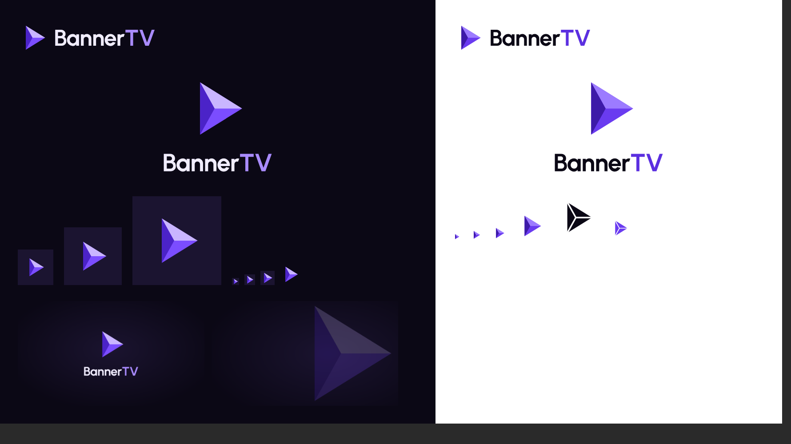

# BannerTV brand

The BannerTV logo is **Prism Play** (concept 10 of the [logo concepts](../docs/brand/logo-concepts.md)), picked by Eyitayo on 26 October 2026. It is a play button cut into three facets, lit from above.



## Files

| Folder | What it holds | Use |
|--------|---------------|-----|
| `logo/` | Mark and lockups as SVG, text already turned into outlines | Everywhere. Use the plain files on dark backgrounds and the `-on-light` files on light ones |
| `logo/bannertv-mark-mono.svg` | One-colour mark with cut lines between the facets. It uses `currentColor` | Single-colour print, watermarks, system tinting |
| `logo/png/` | 512 px mark on a transparent background | Avatars, social images |
| `webos/` | `icon_80.png`, `icon_130.png`, `splash_1920x1080.png` | Copy into `apps/webos/webos-meta/` in Phase 0 |
| `store/` | `icon_400.png`, `launcher_bg_1920x1080.png` | LG Seller Lounge upload |
| `tokens/` | Colours and type as CSS custom properties and JSON | Copy into `apps/webos/src/styles/` in Phase 0 |
| `source/` | The script that draws every file above | Regenerate after any change to the mark or colours |

## appinfo.json

```json
{
  "icon": "icon_80.png",
  "largeIcon": "icon_130.png",
  "iconColor": "#1B1430",
  "splashBackground": "splash_1920x1080.png"
}
```

The icons are full-bleed squares in the tile colour `#1B1430`, so the launcher tile and the icon always match. Give the same hex as the tile colour in LG Seller Lounge.

## Colour

| Role | Dark (TV default) | On light |
|------|-------------------|----------|
| Prism top facet | `#C9B5FF` | `#9C7BFF` |
| Prism bottom facet | `#7B4DFF` | `#6A3BF0` |
| Prism left facet | `#4B23C8` | `#3D1AA8` |
| Background | `#0B0815` | `#FFFFFF` |
| Surfaces | `#120E20`, `#1B1430`, `#261C42` | |
| Text | `#F1EDFF` (17.3:1) | `#0B0815` (19.8:1) |
| Muted text | `#B9B0D6` (9.7:1), `#9A90BD` (6.7:1) | |
| Accent, and "TV" in the wordmark | `#A98BFF` (7.4:1) | `#5B2FE0` (7.2:1) |
| Focus ring | `#C9B5FF` (10.9:1) | |
| Primary button | `#6A3BF0`, white text 6.0:1 | |

Contrast ratios are against the background. The three prism colours belong to the logo and hero moments. Day-to-day UI uses the accent, focus and button colours.

## Type

The wordmark and the UI use **Urbanist** (SIL Open Font License 1.1), Bold for the wordmark. The app must bundle the font files with their licence, because a TV may not reach Google Fonts. Ten-foot sizes at 1920x1080: display 64, title 48, heading 36, body 28, label 24 (px). Nothing smaller than 24 px on screen.

## Using the logo

- Keep clear space around the lockup at least as tall as the capital letters of the wordmark.
- Smallest sizes: the mark at 16 px, the horizontal lockup at 24 px tall.
- Do not recolour the facets outside the palette above, rotate the mark, add outlines or shadows, or set "BannerTV" in another font.
- "Banner" is in the text colour and "TV" in the accent colour. Write the name as one word, BannerTV.

## How it was made

Recraft, the usual vector design tool, was not reachable when the concepts were drawn, so the mark was drawn by hand as SVG on a 100 by 100 grid. The facets meet at 34% of the prism's width, and the prism sits so that 42% of its width falls on the centre line, which makes it look centred. `source/brandgen.py` builds every file from that geometry and the Urbanist Bold font:

```sh
pip install fonttools brotli uharfbuzz
python3 brand/source/brandgen.py path/to/Urbanist-Bold.ttf brand > /tmp/jobs.json
node brand/source/render.js /tmp/jobs.json brand   # needs Playwright and Chromium
```
