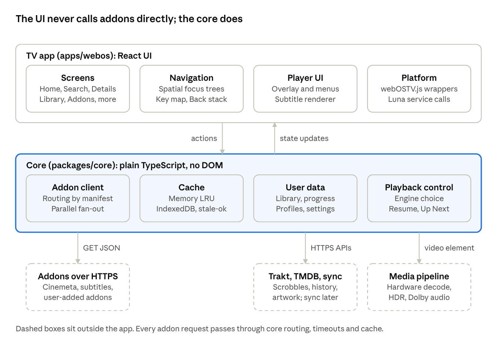
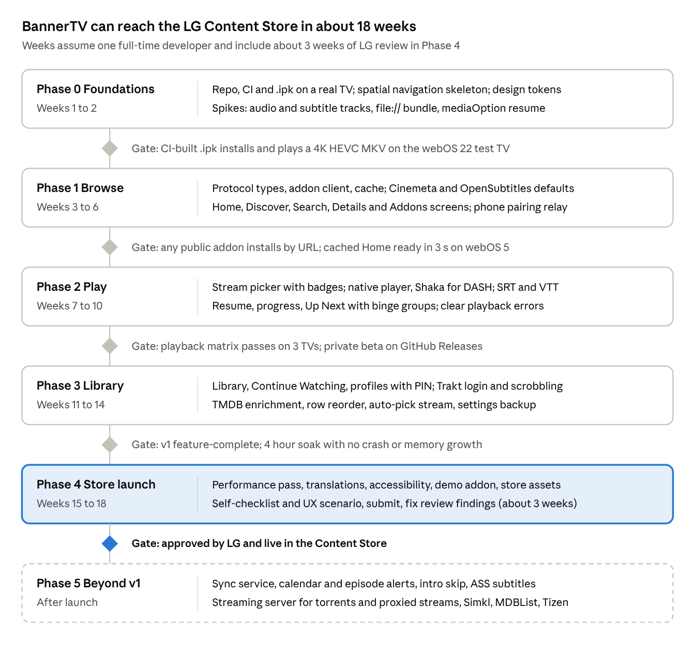

# BannerTV: webOS Streaming Platform Plan

Oct 26, 2026 · @Eyitayo

> Exported from the BannerTV plan doc. The doc is the living version; this file is refreshed when the plan changes.

## Summary

BannerTV is a webOS-native media center that plays content from Stremio-compatible addons, with Nuvio-style extras (Trakt sync, profiles, a customizable home screen) built for the LG remote from day one. It hosts no content itself: users install addon URLs, and BannerTV browses, resolves and plays what those addons return.

**Goals**

- Full compatibility with the Stremio addon protocol, so every existing addon (catalogs, metadata, streams, subtitles) works without changes.
- A 10-foot interface that feels native on LG TVs: instant focus movement, Magic Remote pointer support, the Back key always does the expected thing, and smooth scrolling on 2020+ hardware.
- Playback that uses the TV's hardware decoders through the webOS media pipeline, including 4K HDR, HEVC and Dolby audio where the TV supports them.
- Watch progress, library and settings that survive reinstalls and sync across devices.
- Shipping in the LG Content Store, with a sideload (Developer Mode / Homebrew) build as the fallback channel.

**Non-goals for v1**

- Hosting, indexing or curating any media.
- A built-in torrent engine on the TV (see Risks). Torrent-based addons work only through a streaming server the user runs elsewhere.
- Samsung Tizen, Android TV or mobile apps. The core is kept platform-neutral so these can follow.

**Key decisions at a glance**

| Decision | Choice |
| --- | --- |
| App type | Packaged webOS web app (.ipk), plus a small JS service only if a feature needs it |
| Language and UI | TypeScript, React, Vite |
| Remote navigation | Norigin Spatial Navigation, with webOS key codes mapped centrally |
| Content model | Stremio addon protocol v3 (manifest, catalog, meta, stream, subtitles) |
| Player | Native HTML5 video on the webOS media pipeline first, hls.js or Shaka only as fallbacks |
| Accounts and sync | Local-first storage, optional Trakt, optional BannerTV sync backend in a later phase |
| Minimum platform | webOS 5.0 (2020 TVs) and newer. 2018 to 2019 TVs (webOS 4.x) are not supported |
| Repository | `Eyihbanner1/BannerTv` (private), a pnpm monorepo |
| App ID | com.bannertv.app (confirmed, permanent once uploaded) |
| Launch market | United Kingdom, English only |
| Business model | Free, with optional donations; no in-app payments |
| Primary test TV | LG 65NANO766QA, webOS 22 (7.6.0) |
| LG seller account | Individual seller in LG Seller Lounge |
| Logo | Prism Play: a play button cut into three violet facets, with an Urbanist wordmark. Files and colour tokens live in `brand/` in the repo |

## Product scope and feature parity

BannerTV reaches Stremio parity on browsing, addons and playback by the end of Phase 2, and picks up Nuvio's differentiators (profiles, Trakt-first Up Next, home customization) in Phases 3 and 5. Phases are defined under Milestones. Stremio and Nuvio columns come from the [ElfHosted Nuvio vs Stremio comparison](https://docs.elfhosted.com/nuvio/nuvio-vs-stremio/) and the community [Nuvio settings guide](https://nuvio-wiki.duckdns.org/settings/).

| Area | Feature | Stremio | Nuvio | BannerTV |
| --- | --- | --- | --- | --- |
| Addons | Install addon by manifest URL | Yes | Yes, same addons and config | Phase 1. Typed on screen, or sent from a phone via QR pairing |
| Addons | Configurable addons (settings page per addon) | Yes, opens a web page | Yes | Phase 1. Show the addon's configure URL as a QR code, phone returns the configured manifest URL |
| Addons | Preinstalled defaults | Cinemeta, OpenSubtitles, more | Its own defaults | Phase 1. Cinemeta and OpenSubtitles v3, both removable |
| Addons | Addon catalogs (browse community addons) | Yes | Plugin repos by URL or QR | Phase 3 |
| Addons | Scraper plugins outside the addon protocol | No | Yes | Not planned. Addon protocol only, which keeps the store review simple |
| Browse | Home board, one row per catalog | Yes | Yes, plus Modern, Grid and Classic layouts | Phase 1 rows with a hero banner. Phase 3 reorder and hide rows |
| Browse | Discover with type, catalog and genre filters | Yes | Yes | Phase 1 |
| Browse | Search across all addons | Yes | Yes | Phase 1, on-screen keyboard plus webOS voice input |
| Browse | Details page, seasons and episodes, trailers | Yes | Yes, plus TMDB cast, networks, countdowns | Phase 1. TMDB enrichment in Phase 3 |
| Streams | Stream list grouped by addon | Yes | Yes, plus regex and first-source modes | Phase 2, as the "All streams" escape hatch, with parsed quality, size and codec badges |
| Streams | Reuse last link, auto-pick | Partial | Yes | Phase 2: Watch picks a working stream itself and plays it (see Choosing a stream). Per-title "reuse last link" in Phase 3 |
| Streams | Torrent streams (infoHash) | Local streaming server | P2P toggle | Phase 5, only through a streaming server the user runs on a PC or NAS |
| Streams | Debrid (Real-Debrid, TorBox, Premiumize) | Through addons | TorBox and Premiumize built in | Through addons in v1. Built-in debrid is a Phase 5 option |
| Player | Internal player | Yes | ExoPlayer or libmpv | Phase 2, HTML5 video on the webOS media pipeline |
| Player | Subtitles from addons, styling | Yes | Yes, plus libass for ASS | Phase 2 SRT and VTT with styling. ASS in Phase 5 |
| Player | Embedded audio and subtitle tracks | Yes | Yes, per-title memory | Phase 2. Audio through `audioTracks`; embedded subtitles are not exposed on webOS 22 and need a spike (see Player) |
| Player | Resume, next-episode autoplay, binge groups | Yes | Yes, plus "Still watching?" | Phase 2 |
| Player | Skip intro and outro | No | IntroDB, AniSkip | Phase 5 |
| Library | Save to library, continue watching | Yes | Yes | Phase 3 |
| Library | Calendar and new-episode alerts | Yes | Release countdowns | Phase 5 |
| Accounts | Trakt sync and scrobbling | Yes | Yes, plus Simkl and MDBList | Phase 3 Trakt. Simkl and MDBList in Phase 5 |
| Accounts | Profiles | No free profiles | Free profiles with cloud sync | Phase 3 local profiles. Cloud sync in Phase 5 |
| Accounts | Cross-device sync | Stremio account | Nuvio account | Phase 5, optional BannerTV sync service |
| Safety | Adult content and parental controls | Hides adult addons | Content warnings | Phase 3, profile PIN and adult-addon filter |
| Polish | Themes and languages | Many languages | Accent colours, true black, many languages | Phase 4, English first with i18n wired from Phase 0 |
| Polish | Backup and restore settings | Through account | Export and import | Phase 3, export via QR to phone |
| Apps | Phone companion app | No | No | Phase 5 option: browse and pick on the phone with touch, play on the TV, no focus navigation |

Nuvio also ships a Tizen and webOS smart-TV build ([NuvioTVSmart release notes](https://newreleases.io/project/github/NuvioMedia/NuvioTVSmart/release/0.3.20-beta)), so BannerTV needs a clear edge: native webOS feel, store availability and speed on older LG sets.

## Addon protocol and data compatibility

BannerTV implements the Stremio addon protocol v3 over HTTPS exactly as published, so an addon that works in Stremio works in BannerTV with no changes. The protocol is plain JSON over GET requests, which suits a TV web app well. Reference: the [Stremio addon SDK protocol](https://huggingface.co/spaces/no1b4me/hytranslator/blob/main/node_modules/stremio-addon-sdk/docs/protocol.md) and the [stremio-core resource types](https://mintlify.wiki/Stremio/stremio-core/addons/resources).

**Endpoints the client calls**

| Resource | Path (relative to the addon base URL) | Response | When BannerTV calls it |
| --- | --- | --- | --- |
| Manifest | `/manifest.json` | Manifest object | On install, then refreshed once a day |
| Catalog | `/catalog/{type}/{catalogId}.json` or `/catalog/{type}/{catalogId}/{extra}.json` | `{ metas: MetaPreview[] }` | Home rows, Discover, Search (`search=`), paging (`skip=`), genre filter (`genre=`) |
| Meta | `/meta/{type}/{id}.json` | `{ meta: MetaDetail }` | Details page, first addon whose `idPrefixes` match |
| Stream | `/stream/{type}/{videoId}.json` | `{ streams: Stream[] }` | Stream picker, fan-out to every matching addon |
| Subtitles | `/subtitles/{type}/{videoId}/{extra}.json` | `{ subtitles: Subtitle[] }` | Player start, with `videoHash` and `videoSize` when known |
| Addon catalog | `/addon_catalog/{type}/{catalogId}.json` | `{ addons: [...] }` | Phase 3 addon browser |

The base URL is the manifest URL with `/manifest.json` removed. Extra arguments are one path segment, query-string encoded, for example `search=game%20of%20thrones&skip=100`. Series videos use `{imdbId}:{season}:{episode}`, for example `tt0944947:1:1`. Other ID prefixes (such as `kitsu:` or `tmdb:`) are routed only to addons that declare them in `idPrefixes`.

**Request routing rules**

1. Keep the addon collection as an ordered list. Order decides which addon wins for `meta` and the order of rows on Home.
2. Only call an addon for a resource, type and ID prefix its manifest declares. Never guess.
3. Catalog and meta requests are sequential by priority with a 10 second timeout. Stream and subtitle requests fan out in parallel with a 15 second timeout per addon, and results render as each addon answers.
4. Cap concurrent requests at 6 and fetch only rows near the viewport. TV network stacks and CPUs are slow, and image decoding competes with JSON parsing.

**Caching**

- Honour `cacheMaxAge`, `staleRevalidate` and `staleError` from responses (seconds). Serve stale data instantly and refresh in the background.
- Two tiers: an in-memory LRU for the session and IndexedDB for catalogs, meta and manifests across launches. The webOS engine clears its HTTP cache when the app closes, so the IndexedDB tier is what makes the second launch fast.
- Never cache stream responses for more than a few minutes. Debrid links expire.

**Parsing and validation**

- Shared TypeScript types for `Manifest`, `MetaPreview`, `MetaDetail`, `Video`, `Stream`, `Subtitle`, validated with lenient Zod schemas. A bad item is dropped and logged, never the whole response.
- Support `posterShape` (`poster`, `square`, `landscape`), `links`, `trailers`, `behaviorHints.defaultVideoId` and `hasScheduledVideos`.
- Stream sources: `url` (play), `ytId` (trailer only, through the YouTube app or embed), `externalUrl` and `webosUrl` (open via the app manager), `infoHash` (needs a streaming server, Phase 5). Archive sources (`rarUrls` and similar) are ignored in v1.
- `behaviorHints.notWebReady` is **not** treated as unplayable. The webOS media pipeline plays MKV, HEVC and AC-3 that a desktop browser cannot, so BannerTV tries native playback first and explains failures clearly.
- `behaviorHints.proxyHeaders` streams need request headers that a `<video>` element cannot send. They are shown greyed out unless a streaming server is configured to proxy them.
- `bingeGroup` drives next-episode stream matching. `countryWhitelist`, `filename`, `videoHash` and `videoSize` feed filtering and subtitle matching.

**Integrations around the protocol**

- **Trakt**: device-code OAuth, which is built for TVs (show a code and URL, poll for the token). Scrobble start, pause and stop. Pull watched history and Up Next.
- **TMDB**: optional enrichment for artwork, textless backdrops, cast and episode stills. Needs a BannerTV API key and TMDB attribution on the About screen.
- **Stremio account import** (stretch goal): read a user's addon collection from their Stremio account so switching takes one step. This uses Stremio's unofficial API, so it stays optional.

**Security**

- Addons return data only. Never evaluate addon content, strip HTML from descriptions, and allow only `https:` and `http:` URLs for media and images.
- Store addon URLs carefully: configured addon URLs often embed the user's debrid API key, so they are never logged or sent to analytics.

## webOS platform specifics

BannerTV ships as a packaged webOS web app (.ipk): the UI runs in the TV's Chromium-based web engine and video plays through the TV's native media pipeline behind a standard `<video>` element. webOS 5.0 (Chromium 68, 2020 TVs) is the build baseline.

**Version support**

| webOS TV | Released | Web engine | BannerTV support |
| --- | --- | --- | --- |
| 26 | 2026 | Chromium 132 | Full |
| 25 | 2025 | Chromium 120 | Full |
| 24 | 2024 | Chromium 108 | Full |
| 23 | 2023 | Chromium 94 | Full |
| 22 | 2022 | Chromium 87 | Full |
| 6.x | 2021 | Chromium 79 | Full |
| 5.x | 2020 | Chromium 68 | Full, the build target |
| 4.x | 2018 to 2019 | Chromium 53 | Not supported (dropped) |
| 3.x and older | 2016 to 2017 | Chromium 38 or WebKit | Not supported, show a compatibility screen |

Source: [LG Web API and Web Engine](https://webostv.developer.lge.com/develop/specifications/web-api-and-web-engine). Chromium 68 rules out several modern features without transpiling or fallbacks: optional chaining (Chrome 80), flexbox `gap` (84), `aspect-ratio` (88), `:focus-visible` (86) and `backdrop-filter` (76). The build transpiles to ES2017 and the design system avoids those CSS features.

**Packaging and appinfo.json**

```json
{
  "id": "com.bannertv.app",
  "version": "0.1.0",
  "vendor": "BannerTV",
  "type": "web",
  "main": "index.html",
  "title": "BannerTV",
  "icon": "icon_80.png",
  "largeIcon": "icon_130.png",
  "splashBackground": "splash_1920x1080.png",
  "resolution": "1920x1080",
  "disableBackHistoryAPI": true,
  "handlesRelaunch": true
}
```

- `id`, `title`, `type`, `main`, `icon` and `version` are required for LG Apps. The `id` can never change after publishing, so it must be chosen before the first store upload.
- `version` is strictly `major.minor.patch` and a version number can be uploaded only once.
- Icons are 80x80 and 130x130 PNG, the splash is 1920x1080 PNG. Web apps render at 1920x1080 at most; 4K video still plays at full resolution in the video plane. Reference: [appinfo.json](https://webostv.developer.lge.com/develop/references/appinfo-json).

**Developer tooling**

- webOS TV CLI (`ares-*` commands, installed from npm): `ares-setup-device` registers the TV, `ares-novacom --getkey` pulls its key, `ares-package` builds the .ipk, `ares-install` and `ares-launch` deploy and start it, `ares-inspect` opens Chrome DevTools against the running app. Reference: [CLI developer guide](https://webostv.developer.lge.com/develop/tools/cli-dev-guide).
- Developer Mode app on the TV: needed for real-device testing, lasts 1000 hours before sideloaded apps are removed (reset from the app), and one LG developer account can be active on one TV at a time ([webOS Brew](https://www.webosbrew.org/devmode/)).
- webOS TV Simulator per version for fast UI work on a laptop. Playback and performance must be checked on real TVs.

**Remote control input**

| Key | keyCode | BannerTV behaviour |
| --- | --- | --- |
| Arrows | 37, 38, 39, 40 | Spatial navigation |
| OK | 13 | Activate focused item |
| Back | 461 | Close overlay, then go back a screen, then exit on the root screen |
| Red, Green, Yellow, Blue | 403, 404, 405, 406 | Shortcuts, for example Yellow = add to library, Blue = subtitle menu in the player |
| Play, Pause, Stop | 415, 19, 413 | Player transport |
| Fast forward, Rewind | 417, 412 | Seek plus or minus 10 seconds, hold to accelerate |

Source: [Magic Remote guide](https://webostv.developer.lge.com/develop/guides/magic-remote).

- **Back key**: with `disableBackHistoryAPI: true` the app's router owns key 461. On the root screen, call `webOS.platformBack()`, which shows the system exit prompt on webOS 6+ and returns to Home on 5.x, matching LG's rules ([Back button guide](https://webostv.developer.lge.com/develop/guides/back-button)). A long press always exits to Home.
- **Magic Remote pointer**: pointer mode behaves like a mouse, so hover moves focus and the wheel scrolls rows. Pressing an arrow switches to 5-way mode and hides the pointer, signalled by the `cursorStateChange` event. Every feature must work in both modes.
- **Text input**: use the system on-screen keyboard on focused inputs. Long text (addon URLs) also gets phone entry through a QR pairing page.

**Lifecycle**

- `webOSLaunch` on first start and `webOSRelaunch` when the icon is pressed while running. `handlesRelaunch: true` lets BannerTV route deep links before coming to the foreground ([App lifecycle](https://webostv.developer.lge.com/develop/guides/app-lifecycle-management)).
- `visibilitychange` to hidden means another app took over: pause playback, save progress, stop timers. The user can terminate a suspended app with no warning, so progress is also saved every 10 seconds during playback.
- Packaged apps run from `file://`: cookies are not supported and the HTTP cache is cleared on exit. Settings go in localStorage, data and caches in IndexedDB.

**Luna services (through webOSTV.js)**

| Need | Service or API |
| --- | --- |
| Model, firmware, 4K and HDR capability | `webOS.deviceInfo()` and `com.webos.service.tv.systemproperty` |
| Open trailers in YouTube, open a URL in the browser | `com.webos.applicationManager` launch |
| Network up or down | `com.webos.service.connectionmanager` |
| UI language, audio output | `com.webos.settingsservice` |
| Exit or return to Home | `webOS.platformBack()` |

Exact method names and permissions get confirmed in the Phase 0 spike. A webOS JS service (Node.js running beside the app) is avoided in v1. It adds memory pressure and review risk, and nothing in the v1 scope needs it.

**Media pipeline facts that shape the player**

- Containers: MP4, MKV, TS and more. Video: H.264, HEVC Main and Main10 up to 4K60, VP9 (MKV) and AV1 up to 4K60 on webOS 6.0. Audio: AAC, Dolby Digital and Dolby Digital Plus, DTS listed for MKV on 6.0 (varies by model year). Source: [AV formats on webOS TV 6.0](https://webostv.developer.lge.com/develop/specifications/video-audio-60).
- HLS plays natively (v7 on webOS 5+). DASH is not listed for the native player, so DASH streams go through MSE with Shaka Player. MSE and EME follow the W3C recommendations from webOS 5.0. HTTP/2 needs webOS 5.0. Source: [Streaming protocol and DRM](https://webostv.developer.lge.com/develop/specifications/streaming-protocol-drm).
- Native subtitle support is WebVTT only, so BannerTV renders SRT and VTT itself in an overlay.
- The `mediaOption` parameter on the `<source>` type passes a resume position and adaptive-streaming limits to the native player ([mediaOption parameters](https://webostv.developer.lge.com/develop/guides/mediaoption-parameter)).
- Native HLS does not support playback speeds other than 1.0.

## Architecture

BannerTV is split into a thin React app that only draws screens and handles the remote, and a framework-free core that owns addons, caching, user data and playback decisions. The core never touches the DOM, so it is unit-tested on a laptop and can be reused for a Tizen or web build.



Screens send actions down to the core and subscribe to its state; only the core talks to addons, Trakt, TMDB and the video element.

**What happens when the user presses Play**

1. The Details screen asks the core for streams for a video ID such as `tt0944947:1:1`.
2. The addon client calls every addon whose manifest declares `stream` for that type and ID prefix, in parallel, and pushes results into the store as each addon answers.
3. The user picks a stream. The playback controller chooses the engine (native, Shaka or hls.js), loads saved progress and sets the start position through `mediaOption`.
4. The player UI draws the overlay and subtitles. Progress is written to user data every 10 seconds and scrobbled to Trakt.
5. Near the end, the controller finds the next episode from the series meta and the stream with the same `bingeGroup`.

**State management**

- The core exposes plain observable stores: addons, catalogs, meta, streams, library, progress, settings, profiles.
- React reads them through small Zustand bindings (`useSyncExternalStore` under the hood), so a screen re-renders only when its slice changes.
- Focus memory and the Back stack live in the app layer, because they are about the remote, not the data.

**Storage**

| Data | Where | Notes |
| --- | --- | --- |
| Settings, active profile | localStorage | Small, read synchronously at boot |
| Addon collection and manifests | IndexedDB | Per profile |
| Catalog and meta cache | IndexedDB | Expiry from `cacheMaxAge`, capped at 50 MB with least-recently-used eviction |
| Library, progress, history | IndexedDB | Per profile, exportable for sync |
| Trakt tokens, configured addon URLs | IndexedDB | Contain secrets, never logged or sent to crash reports |

**Background work**

There is no background service in v1. Manifest refresh and prefetching of the first two Home rows run at launch and when the UI is idle. The only server pieces are the phone-pairing relay (Phase 1) and the optional sync API (Phase 5), which uses last-write-wins per item with timestamps.

## Tech stack recommendation

Use TypeScript, React 18 and Vite, with Norigin Spatial Navigation for the remote and a framework-free core package for everything that is not UI. This keeps the hard logic (addons, library, sync, player state) testable on a laptop and portable to Tizen or the web later, while the UI stays fast on a 2020 TV.

| Layer | Choice | Why |
| --- | --- | --- |
| Language | TypeScript, strict mode | One type model shared by core, UI and the later sync service |
| UI | React 18.3 | Large ecosystem, works on Chromium 68 with transpiling; React 19 can follow later, since webOS 4.x is dropped |
| Remote navigation | `@noriginmedia/norigin-spatial-navigation` | Proven on Smart TVs, focus trees per screen, works with the Magic Remote pointer |
| State | Zustand for UI and session state, plain TypeScript stores in core | Small, no provider tree, easy to persist |
| Data validation | Zod, lenient schemas | Addon responses vary wildly in quality |
| Storage | `idb` over IndexedDB, localStorage for small settings | Survives restarts; the webOS HTTP cache does not |
| Styling | CSS Modules plus design tokens as CSS custom properties | No CSS-in-JS runtime cost on slow CPUs |
| Lists | Hand-rolled virtual rows and grids | Only render tiles near the viewport; posters are the main memory cost |
| Player | Native `<video>` first, Shaka Player for DASH, hls.js for HLS with alternate renditions or when native fails | Hardware decoding through the webOS pipeline wherever possible; webOS 22 hides HLS alternates from the native player |
| Subtitles | Own SRT and VTT parser and renderer, JASSUB (libass in WebAssembly) later for ASS | Native support is WebVTT only |
| i18n | i18next | Strings externalized from day one |
| Build | Vite with a classic (non-module) script bundle, ES2017 target. One bundle only, since webOS 4.x is dropped | Module scripts loaded from `file://` can be blocked by CORS in Chromium; verify in Phase 0 |
| Tests | Vitest, Testing Library, Playwright with arrow-key journeys, MSW for addon mocks | Most bugs are focus and data bugs, which these catch off-device |
| Monorepo | pnpm workspaces | Shared core, app and tools packages |
| CI | GitHub Actions: lint, test, build, `ares-package`, attach .ipk to releases | Every merge yields an installable build |
| Crash reporting | Sentry browser SDK, opt-in | Real-device errors are otherwise invisible |
| Sync service (Phase 5) | Hono on Node with Postgres, hosted on Render or Cloudflare | Small API for profiles, library and progress |

**Alternatives considered**

| Option | Strengths | Weaknesses | Verdict |
| --- | --- | --- | --- |
| Enact (LG's React framework with Spotlight and Sandstone) | Official, spatial navigation and TV-tuned virtual lists built in, native webOS look | Tied to LG's look and tooling, smaller community, harder to port to Tizen | Runner-up. Revisit if Norigin focus handling struggles in Phase 1 |
| Lightning JS or Solid with Lightning (WebGL canvas UI) | Best frame rates on weak TVs | No DOM or CSS, harder accessibility and text input, steep learning curve | Not for v1 |
| Preact or plain JavaScript | Smallest bundle | More infrastructure to build by hand | Preact can swap in via `preact/compat` if bundle size hurts |
| Reuse stremio-core compiled to WebAssembly (as Stremio Web does) | Proven behaviour, identical models to Stremio | Couples BannerTV to Stremio's API and accounts, no WebAssembly path on old engines, license review and a Rust toolchain needed | Not chosen. BannerTV's own core mirrors the same semantics |

## UX and navigation

Every screen is designed for a 5-way remote first and a pointer second, viewed from 3 metres away, and the Back key always closes the topmost thing on screen. A collapsed left rail (Home, Search, Discover, Library, Addons, Settings) is the only global navigation.

**Screens**

| Screen | Purpose | Key elements | Phase |
| --- | --- | --- | --- |
| First run | Get to a playable catalog in under a minute | Welcome, default addons preinstalled, optional "add addons from your phone" QR, optional Trakt link | 1 |
| Home | Lean-back browsing | Hero banner for the focused title, Continue Watching row, one row per addon catalog | 1 |
| Discover | Filtered browsing | Type, catalog and genre pickers, poster grid with paging | 1 |
| Search | Find a title fast | On-screen keyboard, recent searches, results grouped by type then addon | 1 |
| Details | Decide what to watch | Backdrop, logo, synopsis, rating, cast, trailer, season tabs, episode list with watched marks, library toggle | 1 |
| Stream picker | Choose a source | Streams grouped by addon, quality, size, codec and HDR badges, sort and filter, "remember choice" | 2 |
| Player | Watch | Minimal overlay, seek bar with thumbnails when available, audio and subtitle menus, Up Next card at the end | 2 |
| Library | Saved titles and history | Tabs for Movies, Series and History, sort by recently watched or added | 3 |
| Addons | Manage addons | Installed list with reorder, configure, remove; install by URL, QR or addon catalog | 1, catalog in 3 |
| Settings | Preferences | Playback, Subtitles, Appearance, Integrations, Profiles, About and licenses | 1 to 4 |
| Profile picker | Multi-user households | Avatars, optional PIN, kids profile | 3 |

**Spatial navigation rules**

1. Each screen owns a focus tree. When a screen is reopened, focus returns to the last focused element.
2. Each row remembers its own last focused tile. Moving up or down lands on that tile, not on column 0.
3. Rows scroll so the focused tile stays at a fixed anchor position near the left. This reduces motion and keeps the hero banner meaningful.
4. Left from the first tile opens the rail. Up from the top row reaches the hero. No dead ends and no focus traps.
5. Back order: close a menu or dialog, then leave the player, then go to the previous screen, then return to Home's first row, then exit via `webOS.platformBack()`.
6. Holding an arrow repeats at one move per 100 ms at most, so the UI never builds a backlog of key events.
7. In pointer mode, hover moves focus, the wheel scrolls rows, and paging arrows appear at row edges. They are hidden in 5-way mode.
8. Overlays (stream picker, menus) are focus-isolated layers; focus cannot leak to the screen underneath.

**10-foot design system**

- Canvas 1920x1080 with a 5% safe area (96 px left and right, 54 px top and bottom).
- Type scale: body 24 px minimum, row titles 32 px, screen titles 48 px, hero title 64 px. One bundled font with a Latin subset to keep the package small.
- Dark theme by default, near-black background rather than pure black for LCD panels, with a true-black option for OLED. Text contrast at least 4.5:1.
- Tiles: poster 2:3 at 220x330, landscape 16:9 at 384x216, square at 240x240. Image requests sized to the tile, never full-size artwork.
- Focus: 1.08 scale plus a 4 px accent ring. The ring is not colour-only, so it works for colour-blind users.
- Motion: transform and opacity only, 150 to 200 ms. A low-power mode (auto-enabled on webOS 5.x) drops the hero video, blur and scaling.

**Accessibility**

- Support LG Audio Guidance by setting `accessibility.supportsAudioGuidance` in appinfo.json and labelling every focusable element with ARIA.
- Subtitle size, colour, background and position settings. A larger-text option for the whole UI.
- Never rely on colour keys alone: every colour-key shortcut also exists as a visible button.

## Player and playback

One playback controller in the core drives three interchangeable engines, and the native webOS pipeline is always tried first because it is the only path with full hardware decoding, HDR and Dolby audio. A failed or stalled stream never strands the user: the controller offers the next best stream in one press. Phase 2's choices are recorded in [ADR 0003](adr/0003-playback.md).

**Engine selection**

| Stream type | Engine | Notes |
| --- | --- | --- |
| Progressive MP4, MKV, WebM, TS over HTTPS | Native `<video>` | Most debrid and direct links. Hardware HEVC, AV1, HDR10 and Dolby Vision where the TV supports them |
| HLS (`.m3u8`) | Native `<video>` | hls.js over MSE when the master playlist has alternate audio or subtitle renditions (native lists only one audio track and no subtitles on webOS 22), or when native fails. hls.js fetches every segment itself, so a host that blocks it before the first picture hands the link back to native |
| DASH (`.mpd`) | Shaka Player 5 over MSE | Not listed for the native player |
| YouTube (`ytId`) | Launch the YouTube app | Trailers only |
| `externalUrl`, `webosUrl` | Launch via the application manager | Opens the target app or browser |
| Torrent (`infoHash`) | User's streaming server, then native | Phase 5 |
| Streams with `proxyHeaders` | User's streaming server proxy, then native | Phase 5 |

**Choosing a stream**

Most people should never see a list of links. Watch picks a stream that will play and starts it, the way Netflix's Play button does; the list stays one press away for those who want it.

1. **Ask early.** All stream addons are asked in parallel when focus rests on a title's Watch button or an episode for 1.5 seconds, never on Home and never during playback. The answers are kept, so Watch starts at once.
2. **Read and rank.** Each stream's name and description are parsed for resolution, HDR type, codec, audio, size, seeders and debrid-cached markers. Torrents and links that need proxy headers are left out. Streams that would likely give no picture or no sound (DTS or TrueHD on TVs without them, Dolby Vision with no HDR10 base on a TV without it, HEVC or AV1 without a decoder, 4K on an HD TV, uncached debrid links) go to the back, tried only when nothing else is left. The rest are ranked by the resolution the TV can show, cached state, HDR, release source, which addons have played on this TV before (a per-addon tally of plays and failures, never the links themselves), seeders, then the addons' own order; camcorder copies go last. "Fastest start" puts cached 1080p and smaller files first. In both, a file too big for the connection (its size over the running time, against a limit that starts at 40 Mbit/s and learns from what this TV has played) comes after every file within it, so a 4K web release beats an 80 GB disc remux that would keep buffering.
3. **Test the best link.** One hidden video element loads just the metadata of the top candidates, one at a time with a 2 second cap, on Details only after the focus rest, and stops when focus moves or the player opens (most LG TVs have one video decoder).
4. **Play and fail over.** If a stream fails before or during playback, the next one starts at the same position, with a short "trying another" note. If it keeps stopping to buffer, a lighter one starts at the same position and the limit is lowered for next time. A stream picked by hand from the list does not fail over, and one picked in the Quality menu is not swapped for a lighter one.
5. **Choices.** The player's Quality menu switches between 4K, 1080p and 720p at the same position. "All streams" lists everything, best first, with badges and the reason any stream cannot play. Settings has "Best quality" or "Fastest start", and link testing on, off or automatic.
6. **Lite mode.** On webOS 5, automatic means no link testing until it is measured on the floor TV.
7. **While it starts,** the title's backdrop and logo show under a shimmer, not a spinner with text.

**Tracks and subtitles**

Phase 0 results on webOS 22 (details in [ADR 0001](adr/0001-react-norigin-classic-bundle.md)): `audioTracks` lists both audio tracks of an MKV, `textTracks` lists none of its 8 subtitle tracks, and native HLS lists one audio track and no subtitles for a stream that has alternates.

- Audio tracks, direct play: `HTMLMediaElement.audioTracks`, exposed on webOS 22, and switching is audible. The webOS 5 floor TV gets the same check. Where it is missing, show the default track and point users to a stream with their language.
- Audio and subtitle renditions, HLS: hls.js, which reads the renditions from the playlist itself, whenever the master playlist declares alternates.
- Embedded subtitles, direct play: not exposed through `textTracks` on webOS 22. The webOS media pipeline's own Luna API (`com.webos.media`: `subscribe` for the track list, `setSubtitleEnable` and `selectTrack` keyed by the video element's `mediaId`) is used by Lampa, Stremio and Nuvio but is unofficial, and has frozen playback on webOS 25. A Lab spike tests it on the TV before the player uses it. Until then the subtitle menu offers addon subtitles.
- Addon subtitles are the main subtitle path: they always work because BannerTV renders them itself, so OpenSubtitles v3 stays a default addon.
- Addon subtitles (OpenSubtitles v3 and others): asked with the stream's file name, hash and size so they match the release, fetched with `fetch` (webOS appears to relax CORS for packaged apps; checked on the TV in Phase 2), gunzipped when needed, and decoded after detecting the text encoding (byte-order mark, then strict UTF-8, then the language's code page such as Windows-1251 or 1256).
- Subtitles are grouped by language, the last chosen language first; pressing the language already showing moves to its next version, the usual fix for subtitles out of step. A file that cannot be read is replaced by the next one in the same language.
- Renderer: SRT, VTT and ASS/SSA (as styled text) parsed into cues, drawn in an overlay above the video plane. Settings for size, colour, background, vertical position and a timing offset adjustable in 100 ms steps. Cues from hls.js and Shaka go through the same renderer.
- ASS and SSA styling through JASSUB is a Phase 5 item for webOS 6+; until then ASS is shown as plain text.

**Progress, resume and next episode**

- Save the position every 10 seconds, on pause and when the app is hidden. Mark as watched at 90% (configurable).
- Resume with "Resume from 42:10" or "Start over" once 30 seconds have played, but not in the last minute. A rewatch resumes too, unless it stopped past 90%. A series offers its latest episode as "Resume S1:E3". The resume position is passed to the native player with `mediaOption` so the TV starts at the right spot instead of seeking after load. On webOS 22 this works for HLS and MP4. With `mediaOption`, `currentTime` reads 0 at the first `playing` event and the real position about 55 ms later, so progress is only saved once the clock has moved past the resume point, never from that first 0.
- Playback health: `getVideoPlaybackQuality()` reports no frames at all on webOS 22, so dropped frames cannot be counted. Stall detection and the "try the next stream" offer use `waiting` and `stalled` events and a timer.
- Up Next card in the last 30 seconds or at 95%, with a 10 second countdown. The next video ID comes from the series meta, and the stream is the one with the same `bingeGroup` from the same addon, falling back to the automatic choice.
- Trakt scrobble start, pause and stop events (Phase 3).

**Player controls**

| Input | Action |
| --- | --- |
| OK | Play or pause, and show the controls |
| Left, Right | Scrub 10 seconds; repeated presses step 30 then 60 seconds, and the seek happens when the presses stop |
| Up, Down | Show the controls (Play, Audio and subtitles, Quality, Other streams, Start over, Next episode) |
| Blue | Audio and subtitles |
| Play, Pause, Stop | Mapped to transport; Stop leaves the player |
| Fast forward, Rewind | Forward 30 seconds, back 10 seconds |
| Back | Cancel a scrub, hide the controls, then leave the player (progress saved) |

**Known limits to explain in the UI**

- Audio passthrough (Atmos, TrueHD) is decided by the TV's sound output settings and eARC, not by the app.
- Dolby Vision profile 7 (Blu-ray remux) often plays as the HDR10 base layer only.
- Native HLS has no playback speed control.
- Media errors are mapped to plain messages, for example "This TV can't decode TrueHD audio. Try a stream with DD+ audio.", with a "Try next stream" button.

**Resource hygiene**

- Reuse one `<video>` element. On exit, clear `src` and call `load()` so the hardware decoder is released.
- While the player is open, drop poster images from Home rows to free memory, and restore them on return.

**Debrid**

In v1, debrid works through addons: the user configures an addon with their Real-Debrid, AllDebrid, TorBox or Premiumize key, and the addon returns plain HTTPS links that play natively. Built-in debrid accounts are a Phase 5 option.

## Repository structure

The code lives in one pnpm monorepo at [Eyihbanner1/BannerTv](https://github.com/Eyihbanner1/BannerTv), a private repository. This plan is kept there as `docs/PLAN.md`.

```text
bannertv/
├── apps/
│   └── webos/                 TV app: React UI and webOS glue
│       ├── webos-meta/        appinfo.json, icons, splash
│       ├── src/
│       │   ├── app/           shell, router, back stack, providers
│       │   ├── screens/       Home, Discover, Search, Details, Streams, Player, Library, Addons, Settings
│       │   ├── components/    Tile, Row, Grid, Rail, Dialog, Keyboard, Badge
│       │   ├── navigation/    spatial navigation setup, key map, focus memory
│       │   ├── platform/      webOSTV.js wrappers, Luna calls, capability detection
│       │   ├── player/        engines (native, Shaka, hls.js), subtitle renderer, overlay
│       │   └── styles/        design tokens, global CSS
│       ├── index.html
│       └── vite.config.ts
├── brand/                     logo, webOS icons, store images, colour tokens
├── packages/
│   ├── protocol/              Stremio addon types and Zod schemas
│   ├── core/                  addon client, cache, library, progress, settings, profiles (no DOM, no React)
│   └── integrations/          Trakt, TMDB, OpenSubtitles helpers
├── services/
│   ├── pair/                  tiny relay for "send addon URL from phone" (Phase 1)
│   └── sync/                  profiles, library and progress sync API (Phase 5)
├── tools/
│   └── scripts/               ares-cli wrappers, release and version scripts
├── docs/
│   ├── PLAN.md                this plan
│   ├── adr/                   architecture decision records
│   └── store/                 UX scenario document, self-checklist, screenshots
├── .github/workflows/         ci.yml, release.yml
├── pnpm-workspace.yaml
├── tsconfig.base.json
└── README.md
```

**Conventions**

- `main` is protected and only changes through pull requests with green CI.
- Conventional Commits (`feat:`, `fix:`, `chore:`), short-lived branches named `feat/...` or `fix/...`.
- Git tags `vX.Y.Z` always equal the `version` in appinfo.json, enforced by a script in CI.
- Each big decision gets a one-page ADR in `docs/adr` (for example "0001 React and Norigin over Enact").
- Secrets (TMDB key, Trakt client ID, Sentry DSN) are injected at build time from GitHub Actions secrets and never committed.

**CI and release pipelines**

| Workflow | Trigger | Steps |
| --- | --- | --- |
| `ci.yml` | Every pull request | Install, typecheck, lint, unit tests, build, Playwright journeys at 1920x1080 with arrow keys, `ares-package`, upload the .ipk as an artifact |
| `release.yml` | Tag `v*` | Build, package, attach the .ipk to a GitHub Release, publish a Homebrew Channel repository manifest for sideload users |
| `services.yml` | Changes under `services/` | Test and deploy the pairing relay, later the sync API |

The phone pairing feature needs the small `pair` relay because a webOS web app cannot listen for connections: the TV shows a QR code with a short code, the phone page posts the addon URL to the relay, and the TV polls for it. Entries expire after 10 minutes and nothing else is stored.

## Milestones and phases

A private beta that browses and plays is ready at the end of week 10, and the store launch follows around week 18 if one developer works on it full time. Each phase ends at a gate that must pass before the next starts.



Phases 0 to 2 are the minimum product; if time runs short, Phase 3's profiles and TMDB enrichment slip, never the Phase 2 playback gate.

**Phase 0 tasks to start with**

- [x] Eyitayo creates the `Eyihbanner1/BannerTv` repository and confirms the app ID
- [x] Scaffold the monorepo: pnpm, TypeScript, Vite, ESLint, Vitest, and a CI job that outputs an .ipk
- [ ] Enable Developer Mode on the LG 65NANO766QA (webOS 22) and register it with `ares-setup-device`. The first install used the rooted TV's own install service instead, so this path is untested
- [x] Spike 1 on webOS 22: the classic script bundle loads from `file://`. webOS 5 waits for the floor TV
- [x] Spike 2: `audioTracks` lists MKV audio tracks; `textTracks` lists no embedded subtitles; native HLS hides alternate renditions
- [ ] Spike 3: `mediaOption` start position works for HLS and MP4; HDR10 file not tested yet. This TV has no Dolby Vision, so profile 8 waits for a TV that has it
- [x] Spatial navigation skeleton: rail, two rows of tiles, Back key handling
- [x] Record the spike results in ADR 0001 and adjust this plan where they differ
- [ ] Buy a used 2020 LG TV on webOS 5 as the performance floor, before the end of Phase 1

## Testing, QA and performance

Most bugs are caught off-device in CI, but no release ships until it passes a real-TV checklist on at least three model years, with the 2020 low-end TV as the performance floor.

**Test layers**

| Layer | Tool | Covers | Runs |
| --- | --- | --- | --- |
| Unit | Vitest | Protocol parsing, routing, caching, stream badge parsing, subtitle parsing, progress maths | Every pull request |
| Component | Vitest and Testing Library | Focus behaviour of Row, Grid, Rail, Dialog, Keyboard | Every pull request |
| Addon contract | Recorded fixtures from about 20 popular addons, plus a live smoke run | Compatibility with real-world addon responses | Fixtures per pull request, live nightly |
| End to end | Playwright, Chromium at 1920x1080, keyboard only, webOS key codes | First run, browse to play with a test file, Back stack, search | Every pull request |
| Simulator | webOS TV Simulator per version | Layout and engine differences | Weekly |
| Device | Real TVs via `ares-install` and `ares-inspect` | Playback matrix, performance, memory, soak | Before every release |

**Device matrix (minimum)**

- webOS 5.x, a 2020 entry-level LG UHD LCD. This is the performance floor. Not owned yet; buy a used one before the end of Phase 1.
- webOS 22: Eyitayo's LG 65NANO766QA (webOS 22, 7.6.0, Chromium 87). This is the primary development TV from day one.
- webOS 24 or newer, ideally an OLED for Dolby Vision and Atmos checks.

**Playback matrix**

Built from legal test media (Blender open movies and public codec samples), each file played through the full stream path on every device in the matrix:

- MP4, H.264 and AAC, 1080p
- MKV, HEVC 10-bit HDR10 with DD+, 4K
- MKV, HEVC Dolby Vision profile 8, 4K
- MKV, AV1, 4K
- MKV with DTS audio, and MKV with TrueHD Atmos (expected: warning or graceful failure)
- HLS with multiple audio renditions; DASH via Shaka
- External SRT in Windows-1252 and UTF-8; VTT with styling
- Resume at 1 hour into a 2 hour file; next-episode handoff

**Performance budgets (measured on the webOS 5.x floor TV)**

| Metric | Budget |
| --- | --- |
| Cold start to interactive Home, with cache | 3 s or less |
| First launch, no cache | 6 s or less |
| Key press to visible focus change, p95 | 100 ms or less |
| Holding an arrow across a row | 30 fps or better on 5.x, 60 fps on webOS 22+ |
| Initial JavaScript, gzipped (Shaka and hls.js lazy-loaded) | 600 KB or less |
| JavaScript heap on Home | 150 MB or less |
| DOM nodes on Home | 3,000 or fewer |
| Stream selected to first frame, debrid HTTPS link | 4 s or less on a good connection |
| .ipk size | 15 MB or less |

Performance marks feed a hidden debug overlay (opened with a colour-key sequence) so testers can read numbers on the TV without a laptop attached.

**Release QA checklist**

- [ ] Back key correct on every screen, exit prompt on the root screen
- [ ] Every control reachable by 5-way and by pointer
- [ ] Network cable pulled during playback and during browsing: clear message, recovery on reconnect
- [ ] App hidden and relaunched during playback: paused, progress saved, resumes cleanly
- [ ] 4 hour playback soak with no crash or memory growth
- [ ] Empty states: no addons, every addon offline, no streams found
- [ ] Long titles, right-to-left text in metadata, missing artwork
- [ ] Language switch and subtitle styling persist after restart
- [ ] LG self-checklist items filled with real results

## Packaging, deployment and LG Content Store

BannerTV ships through two channels: the LG Content Store for everyone, and GitHub Releases for beta testers and sideloading. Each store submission, including every update, goes through LG review, so plan about three weeks per submission and keep urgent fixes on the beta channel until approved.

**Store submission steps**

1. Create an LG account and register in [LG Seller Lounge](https://webostv.developer.lge.com/distribute/app-ecosystem) as an individual seller (decided). Your personal name is shown as the Seller ID. A corporate account is only worth it if BannerTV ever takes payments.
2. Register the App ID. It is permanent and must equal `id` in appinfo.json.
3. Upload the production .ipk built by `release.yml`. The version must be new; a version number can be uploaded only once.
4. Upload store assets: icon 400x400 or larger, tile colour as an exact hex, a primary screenshot at 1280x720, 2 to 5 more screenshots, launcher and splash backgrounds at 1920x1080, plus name and description for each language ([Brightcove's LG submission guide](https://beacon-help.support.brightcove.com/publishing-apps/lg/submitting-to-lg.html)).
5. Fill in Test Info: the App Self Checklist with real results (an empty or thin checklist is an automatic rejection) and the UX scenario document describing every screen and flow ([App approval process](https://webostv.developer.lge.com/distribute/app-approval-process)).
6. Fill in Service Info: countries, category (Entertainment), age rating.
7. Submit. LG runs a pretest (submitted information), a function test (no errors) and a content test (no inappropriate content). Fix the listed issues and resubmit if rejected.

**Making the app reviewable**

BannerTV has no content of its own, so a tester who opens it needs something legal to play. The store build preinstalls Cinemeta for metadata and a small first-party "BannerTV Demo" addon that streams public-domain and Creative Commons films (for example the Blender open movies). The UX scenario document walks the tester through browsing, playing, subtitles and adding an addon by URL.

**Store build rules**

- No third-party stream addons preinstalled or promoted. Users add addons by URL themselves, the same model Stremio uses in the LG store.
- A first-run notice that BannerTV hosts no content and that users are responsible for the addons they install.
- The adult-content filter is on by default.

**UK launch, donations and domain**

- Launch in the United Kingdom only, in English. Adding countries later is a Service Info change in Seller Lounge, not a new build.
- Donations: a QR code on the About screen that opens an external page such as Ko-fi or GitHub Sponsors. With no in-app payments, an individual Seller Lounge account is enough. Check the Seller Lounge guide on external payment links before submitting; if they are not allowed in the app, keep the link on the website only.
- No domain is needed for the app ID. The submission still needs a privacy policy URL and a deep-link test URL you control, so host both on GitHub Pages until a domain (for example bannertv.co.uk) is bought.

**Beta and sideload channel**

- Every tagged release attaches the .ipk to GitHub Releases.
- Testers install through Developer Mode with webOS Dev Manager or `ares-install`. Developer Mode installs disappear after 1000 hours unless the timer is reset.
- Rooted TVs can install and auto-update through a Homebrew Channel repository manifest published by the release workflow.

**Release train**

- Monthly store releases after launch, with beta builds weekly.
- `version` in appinfo.json and the git tag move together; patch versions for fixes, minor versions for features.

## Risks, legal and open questions

The two risks that could sink the project were LG rejecting the app in its content test and webOS not exposing audio and subtitle tracks for direct-play files. The first is handled by how the store build is shaped. Phase 0 settled most of the second on webOS 22: audio tracks are exposed, embedded subtitles are not, and addon subtitles cover the gap.

| Risk | Likelihood | Impact | Mitigation |
| --- | --- | --- | --- |
| LG rejects BannerTV as a piracy tool | Medium | High | Demo addon with legal content, no third-party stream addons preinstalled or promoted, first-run disclaimer, adult filter on; sideload channel as fallback |
| Embedded subtitles not available for MKV direct play | Confirmed on webOS 22 | Medium | Addon subtitles rendered by BannerTV as the main path; Phase 2 spike on the webOS media pipeline API; clear UX when a track cannot be changed. Audio track switching is exposed on webOS 22 |
| Slow UI on 2020 low-end TVs | Medium | High | Performance budgets, virtual lists, low-power mode, floor TV bought by the end of Phase 1, development on the webOS 22 TV meanwhile |
| One-person team runs out of time | High | High | Strict phase gates, MVP cut at Phase 2, everything optional pushed to Phase 5 |
| Store review takes about 3 weeks per update | High | Medium | Monthly store releases, weekly beta builds, batch fixes |
| Addon breakage: CORS, `proxyHeaders`, malformed JSON | Medium | Medium | Lenient parsing, addon contract fixtures, clear per-addon errors, streaming-server proxy later |
| API keys and Trakt client secret extractable from the app bundle | Medium | Medium | Restricted keys, rotation, move token exchange behind the sync service in Phase 5 |
| Module scripts or other engine quirks under `file://` | Low | Medium | Phase 0 packaging spike, classic script bundle |
| Developer Mode expiry interrupts testing | High | Low | Reset the timer weekly, keep test TVs logged in |
| Stremio's unofficial API changes (account import) | Medium | Low | Feature stays optional |
| "BannerTV" name conflicts with an existing trademark | Low | Medium | Trademark search before store submission; never use Stremio or Nuvio branding |

**Legal considerations** (not legal advice)

- BannerTV is a neutral client, like a browser or Stremio itself. Legal exposure rises sharply if the project ships or promotes addons that point to infringing content, runs peer-to-peer on the TV, or charges for access to content. v1 does none of these.
- Publish terms of use and a privacy policy before store launch (the store listing and the Trakt and TMDB integrations need them).
- Respect TMDB and Trakt API terms, including attribution and rate limits.
- Get a short legal review before adding payments or a hosted sync service.
- UK launch: rights holders and anti-piracy groups in the UK actively pursue apps and sellers that promote infringing streams. Keep the store listing, screenshots, demo addon and donation page free of copyrighted titles and of any mention of third-party stream addons.

**Open questions for Eyitayo**

- [x] Repository: created as `Eyihbanner1/BannerTv`, private. No licence is needed while it stays private.
- [x] App ID: `com.bannertv.app` confirmed. No domain yet, which is fine for the ID (see the Store section).
- [x] LG Seller Lounge: register as an individual seller.
- [x] Test TVs: LG 65NANO766QA on webOS 22. A used 2020 webOS 5 TV is still needed as the performance floor.
- [x] 2018 to 2019 TVs (webOS 4.x): dropped. The minimum is webOS 5.0 (2020 TVs).
- [x] Business model: free, with optional donations.
- [x] Launch: United Kingdom, English only.
- [x] Logo: Prism Play (concept 10 on the [logo concepts canvas](https://claude.ai/artifact/44B7TcVyefmheVMSe1E8JX)). The brand kit (logo files, webOS icons, splash, store images, colour and type tokens) is in [`brand/`](../brand/README.md) in the repo.

## Sources

- [Stremio addon SDK protocol](https://huggingface.co/spaces/no1b4me/hytranslator/blob/main/node_modules/stremio-addon-sdk/docs/protocol.md)
- [stremio-core addon resources](https://mintlify.wiki/Stremio/stremio-core/addons/resources)
- [Nuvio vs Stremio, ElfHosted](https://docs.elfhosted.com/nuvio/nuvio-vs-stremio/)
- [Nuvio settings guide (community)](https://nuvio-wiki.duckdns.org/settings/)
- [NuvioTVSmart 0.3.20-beta release notes](https://newreleases.io/project/github/NuvioMedia/NuvioTVSmart/release/0.3.20-beta)
- [webOS TV Web API and Web Engine](https://webostv.developer.lge.com/develop/specifications/web-api-and-web-engine)
- [webOS TV appinfo.json](https://webostv.developer.lge.com/develop/references/appinfo-json)
- [webOS TV CLI developer guide](https://webostv.developer.lge.com/develop/tools/cli-dev-guide)
- [webOS TV Back button guide](https://webostv.developer.lge.com/develop/guides/back-button)
- [webOS TV Magic Remote guide](https://webostv.developer.lge.com/develop/guides/magic-remote)
- [webOS TV app lifecycle](https://webostv.developer.lge.com/develop/guides/app-lifecycle-management)
- [webOS TV 6.0 audio and video formats](https://webostv.developer.lge.com/develop/specifications/video-audio-60)
- [webOS TV streaming protocol and DRM](https://webostv.developer.lge.com/develop/specifications/streaming-protocol-drm)
- [webOS TV mediaOption parameters](https://webostv.developer.lge.com/develop/guides/mediaoption-parameter)
- [webOS TV app approval process](https://webostv.developer.lge.com/distribute/app-approval-process)
- [webOS TV app ecosystem](https://webostv.developer.lge.com/distribute/app-ecosystem)
- [Submitting apps to the LG store, Brightcove](https://beacon-help.support.brightcove.com/publishing-apps/lg/submitting-to-lg.html)
- [webOS Brew, Developer Mode](https://www.webosbrew.org/devmode/)
- [Moonfin smart TV playback notes](https://github.com/Moonfin-Client/Smart-TV/wiki/Playback-and-Codecs)
