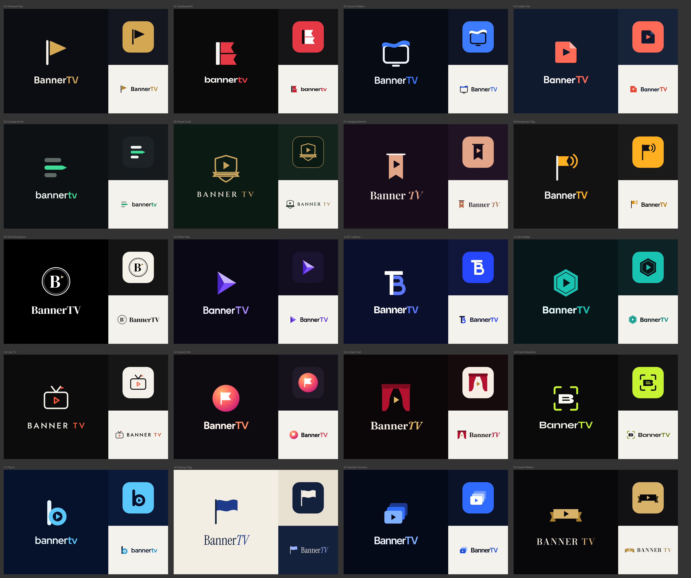

# BannerTV logo concepts

Twenty logo directions for BannerTV, drawn on 26 October 2026. Each concept is shown three ways: the main lockup on its dark ground, the TV launcher tile, and the lockup on a light background.

- Live canvas (private, share it from its Share menu): https://claude.ai/artifact/44B7TcVyefmheVMSe1E8JX
- Static overview: [logo-concepts.png](logo-concepts.png)

## How these were made

Recraft was not reachable in this session, so every mark was drawn by hand as vector SVG on a 100 by 100 grid. Each one is a single SVG symbol coloured through CSS variables, so the chosen mark can be recoloured and exported at any size without redrawing. The wordmarks use free Google Fonts.

## The concepts

| # | Name | Idea | Type | Colours |
|---|------|------|------|---------|
| 01 | Pennant Play | A pennant whose flag is a play button: banner and play in one shape | Sora | Gold #D4A853 on near-black #0B0D12 |
| 02 | Swallowtail B | A bold B whose right edge is cut like a swallowtail banner | Unbounded | Red #E63946 on black #0A0A0B |
| 03 | Screen Ribbon | A TV outline with a ribbon waving across its top edge | Manrope | Electric blue #3D7BFF on #070B14 |
| 04 | Folded Tile | A play tile with one corner folded like a banner | Outfit | Coral #FF6B57 on navy #0F1A2E |
| 05 | Catalog Rows | Three rows, the middle one a pennant, echoing the home screen rows | Space Grotesk | Mint #3DDC97 on #0E1113 |
| 06 | Royal Crest | A shield with a play button and a ribbon band | Cinzel | Antique gold #C9A45C on green #0C1A14 |
| 07 | Hanging Banner | A banner hanging from a rod, with a play cut-out | Playfair Display | Copper #E3A587 on plum #170C1A |
| 08 | Broadcast Flag | A flag sending out broadcast waves | Plus Jakarta Sans | Amber #FFB020 on charcoal #121212 |
| 09 | Serif Monogram | A serif B in a double ring with a small play mark | DM Serif Display | Black, white and muted gold |
| 10 | Prism Play | A play triangle split into three facets | Urbanist | Violets #C9B5FF, #7B4DFF, #4B23C8 |
| 11 | BT Ligature | A T and a B fused into one letter | Bricolage Grotesque | Royal blue #5B78FF on #0A0F2C |
| 12 | Hex Badge | A hexagon badge with an inner outline and a play | Lexend | Teal #19C3B1 on #071618 |
| 13 | Line TV | A thin-line retro TV whose antenna carries a pennant | Jost | Orange #FF5A36 on black #0C0C0C |
| 14 | Sunset Orb | A gradient orb with a white flag | Figtree | Gradient #FFB36B to #C2187A |
| 15 | Curtain Call | Theatre curtains opening on a gold play | Fraunces | Crimson #B3122E and gold #E3B964 |
| 16 | Frame Brackets | A heavy B inside viewfinder corners | Syne | Lime #C6F432 on black #0A0A0A |
| 17 | Play b | A lowercase b whose bowl holds a play button | Red Hat Display | Sky #5AC8FA on navy #06122B |
| 18 | Waving Flag | A navy flag waving on a pole, light background first | Instrument Serif | Navy #13213C on cream #F3EEE3 |
| 19 | Stacked Screens | Three stacked screens, many sources in one app | Inter Tight | Blues #7FB0FF, #2F6BFF, #1B3A8F |
| 20 | Award Ribbon | A gold award ribbon with a play cut-out | Bodoni Moda | Gold #D9B26A on #08080A |

## After a pick

1. Refine the chosen mark: optical tweaks at 16 to 32 px, final colours, spacing rules.
2. Export a master SVG and the webOS app assets (`icon`, `largeIcon`, splash and launcher background) plus LG Content Store images.
3. Record the final palette and type as design tokens for the app.
